<div align="center">



[](https://growvib.com)
[](https://growvib.com/mcp)
[](https://growvib.com/x402)

</div>

### 🤖 Let your agent do the growing



```bash
claude plugin marketplace add GrowVib/agent-plugins
claude plugin install growvib@growvib
```

Using another MCP client? Add `https://api.growvib.com/mcp-public`. It needs no auth. Already have a GrowVib account? `https://api.growvib.com/mcp` (OAuth) gives your agent your balance and orders. Listed in the official MCP registry as `com.growvib/growvib`.

### 📦 Open source

- [**agent-plugins**](https://github.com/growvib/agent-plugins) · Claude Code plugin marketplace with the `buy-growth` skill
- [**x402-mcp-lab**](https://github.com/growvib/x402-mcp-lab) · a workbench for paid MCP tools over x402

<div align="center">
<sub><a href="https://growvib.com">Website</a> · <a href="https://growvib.com/mcp">MCP docs</a> · <a href="https://growvib.com/x402">x402 &amp; USDC</a> · <a href="https://api.growvib.com/.well-known/mcp/server-card.json">Server card</a></sub>
</div>
